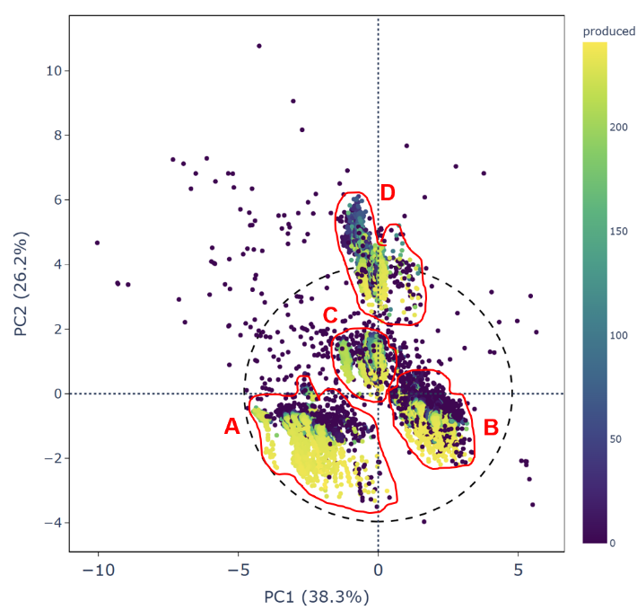
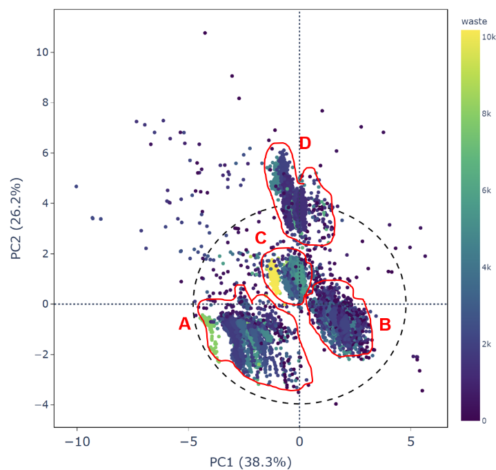
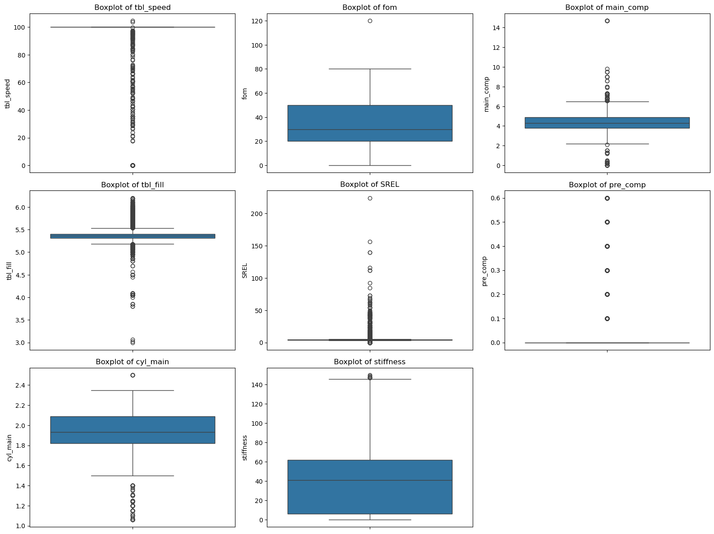
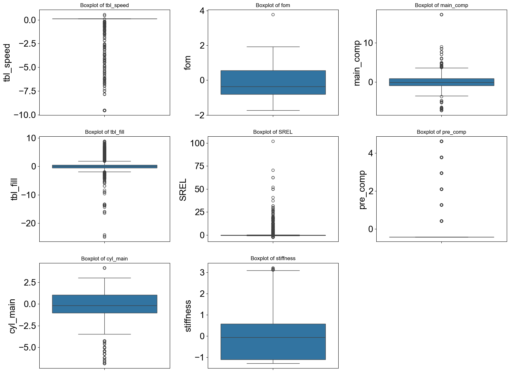
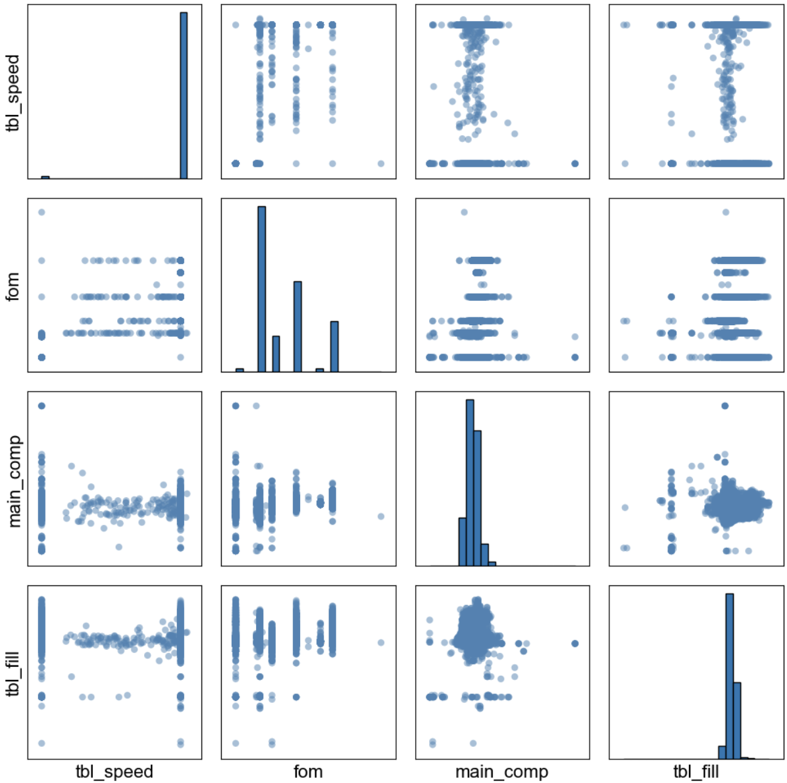
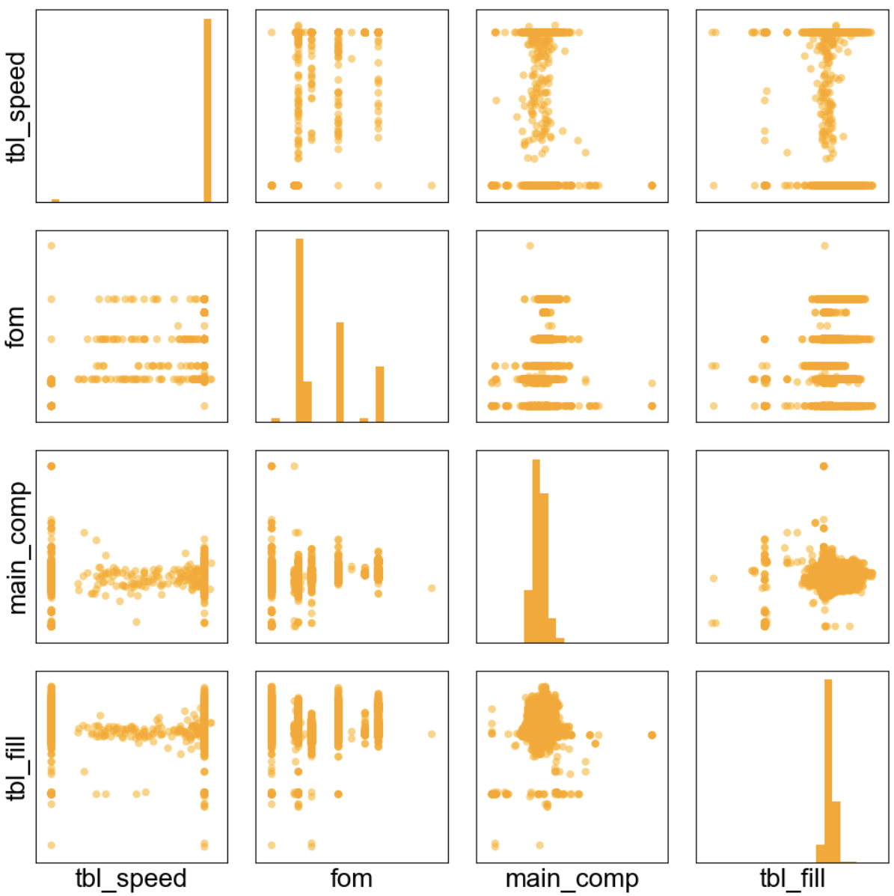
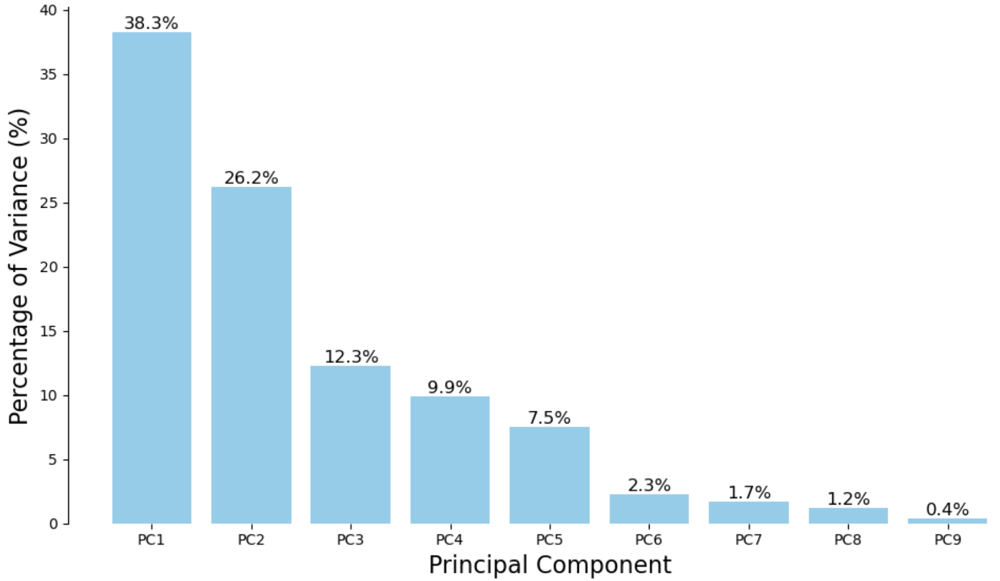
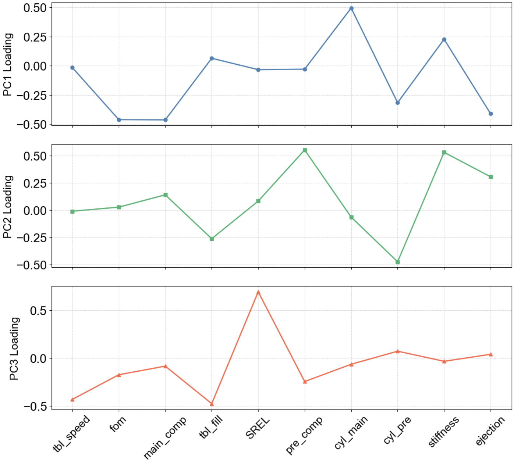
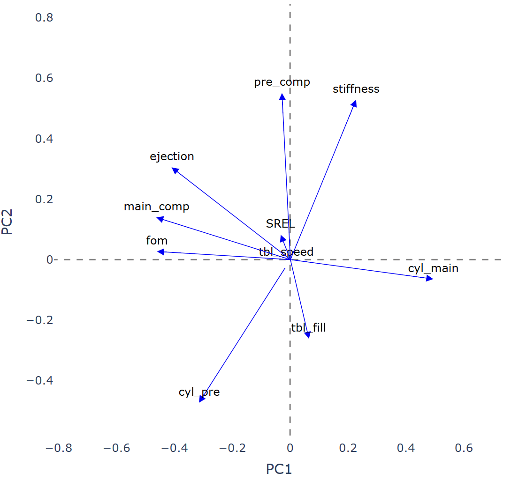
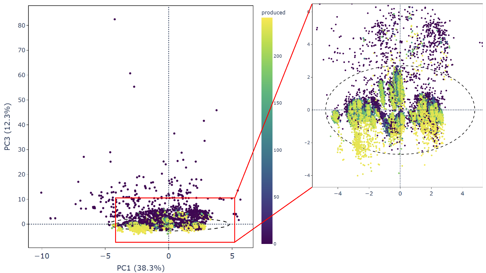

# Nanocluster Data Analysis

## Tablet press operating conditions, production and waste

Which tablet press settings are worth testing in a follow-up experiment? This project uses principal component analysis (PCA) to explore ten sensor measurements from pharmaceutical tablet manufacturing. The first two components captured **64.5%** of the reported variation in the process measurements. Colouring the same observations by production and waste counts reveals a trade-off worth investigating.

| Tablet production | Tablet waste |
| --- | --- |
|  |  |

Higher production counts occur in parts of the negative-PC1 region, where some observations also show elevated waste. The colour scales represent counts. Comparing rejection rates across operating conditions would also require accounting for production volume.

## Preparing the measurements

1. **Remove identifiers.** Drop the timestamp, campaign, batch and code before comparing sensor measurements. Keep the production and waste counts alongside each observation for colouring the score plots.
2. **Check completeness and duplicates.** Drop rows with missing values in the retained columns and check for repeated measurement records. The report describes 40 incomplete records and no duplicates. Its summary tables give approximately 107,000 observations before processing and 81,700 afterwards. The stated cleaning steps do not fully explain that difference. The script prints the number of rows removed at each step so it can be checked against the input CSV.
3. **Inspect extreme readings.** Use boxplots and scatter matrices to examine the sensor distributions. Retain values beyond the boxplot whiskers because they may represent genuine changes in operating conditions.
4. **Standardise ten process variables.** Apply z-score scaling so differences in measurement units do not dominate the PCA. Fit the model using only those measurements, then pair its scores with the observed outcomes.

| Before standardisation | After standardisation |
| --- | --- |
|  |  |
|  |  |

## Interpreting the components



PC1 explained **38.3%** of the variance and PC2 explained **26.2%**. PC3 added **12.3%**, bringing the total to **76.8%**. These percentages describe variation in the sensors. Production and waste were held out of the PCA fit.

| Feature weights across PC1, PC2 and PC3 | Feature directions in the PC1–PC2 plane |
| --- | --- |
|  |  |

In the reported orientation, filling device speed (`fom`) and main compression force (`main_comp`) have negative PC1 weights. Pre-compression height (`cyl_pre`) also points towards the negative-PC1, negative-PC2 region. The report shortlists these three variables and ejection force for a designed experiment to test their relationship with production and waste.



The third component brings compression-force variability (`SREL`) into view. It has a positive PC3 loading, while many observations with higher production counts lie towards negative PC3. The dashed ellipses in the score plots give a covariance-based 95% reference contour.

## Run the analysis

Use Python 3 and the original semicolon-delimited course dataset, `ceng0068project.csv`. The dataset is separate from this repository. From the repository directory, run:

```bash
python -m pip install pandas numpy matplotlib scipy scikit-learn
python pca_analysis.py /path/to/ceng0068project.csv --output outputs
```

| Appendix | File | Role |
| --- | --- | --- |
| A | [cleaning.py](cleaning.py) | Reads the CSV, reports missing and duplicate rows, and plots distributions in the original units. |
| B | [standardisation.py](standardisation.py) | Selects the ten sensor features and scales them to unit variance. |
| C | [visualisation.py](visualisation.py) | Repeats the distribution plots on the standardised measurements. |
| D | [pca_analysis.py](pca_analysis.py) | Runs all four stages, fits nine components, and exports the scree, loading and score plots. |

The CSV must contain `timestamp`, `campaign`, `batch`, `code`, the outcomes `produced` and `waste`, and the sensor columns `tbl_speed`, `fom`, `main_comp`, `tbl_fill`, `SREL`, `pre_comp`, `cyl_main`, `cyl_pre`, `stiffness` and `ejection`.

The ten PNGs in [images](images/) are the original report panels. The scripts export fresh plots to the output directory with the same filenames. The original score plots include hand-added annotations and a detail view. Reruns draw the scores and reference ellipses directly from the supplied data.

**Dataset background** · Žagar and Mihelič (2022), [Big data collection in pharmaceutical manufacturing and its use for product quality predictions](https://doi.org/10.1038/s41597-022-01203-x).
